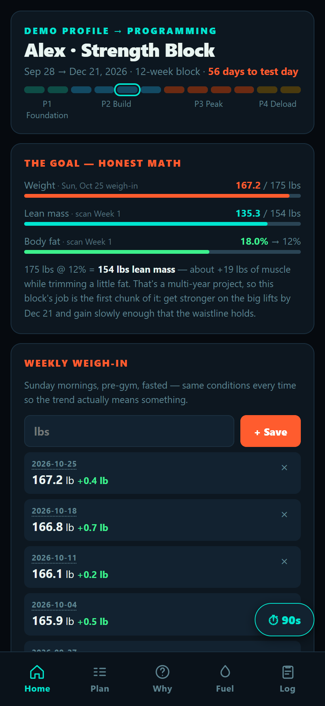
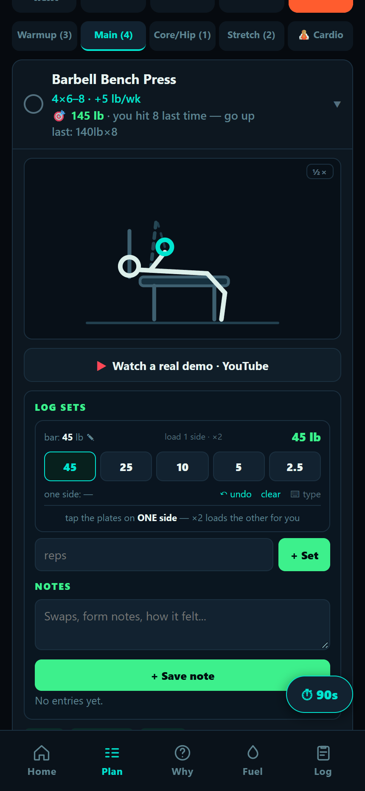
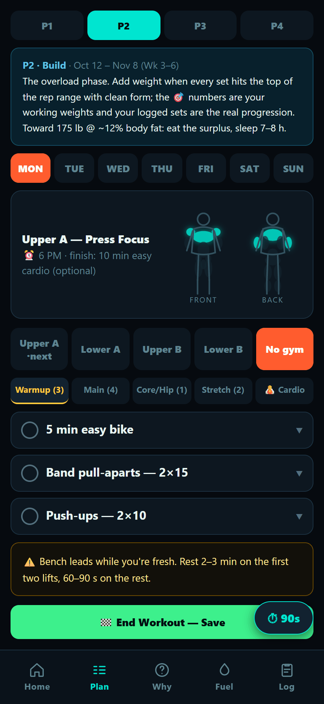
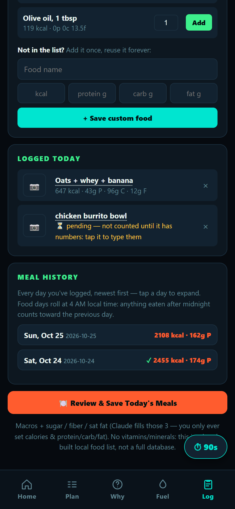
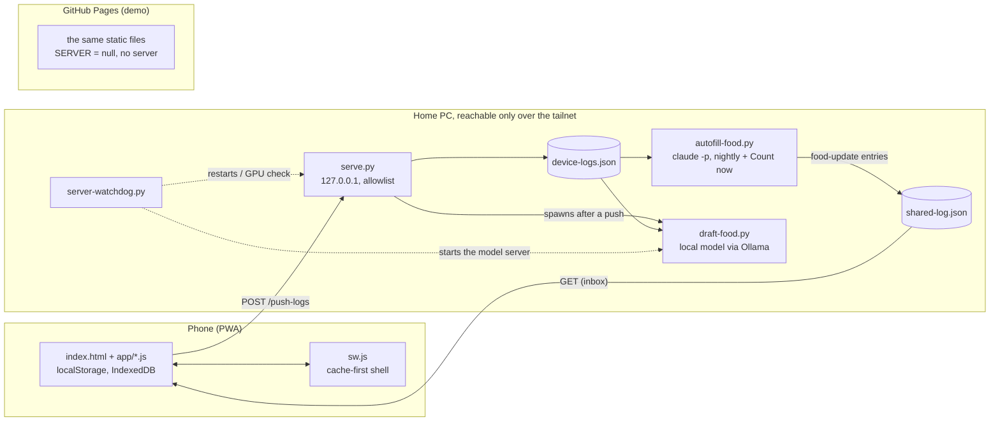

# Training PWA

An offline-first training and nutrition tracker for the phone. It runs a periodized program (phases, weekly
targets derived from your own logged sets, an animated diagram for every exercise) and a meal log where you
snap or type a meal and it gets counted later by an AI estimator that is never allowed to guess. The client
is plain HTML, CSS and JavaScript with no framework, no build step and no dependencies; an optional Python
companion server on a home PC adds sync, the meal count and a local-model draft estimate. Its owner uses it
every day, and every change ships with a test harness that proves what it did not change.

**Live demo:** https://danielcheer.github.io/training-pwa/ (fictional data, stored only in your browser).

<p>
  
  
  
  
</p>

More: [the week](docs/img/week.png) · [meal history](docs/img/meal-history.png) · [status strip](docs/img/status-strip.png)

## Why it's interesting

### 1. Offline-first PWA with no framework and no build step

The app has to open in a gym basement with no signal. A service worker precaches the shell and serves it
cache-first; files the PC writes are network-only, and an offline navigation falls back to the cached app.
New versions install in the background and take over on the next launch (or offer a reload if you're in the
middle of typing). There is no bundler: `index.html` loads eleven classic scripts in a fixed order, and the
test harness runs those same files in the same order in one Node `vm` context, so a script that calls into a
later one fails the tests the way it would fail in the browser. A full store fails loud (a banner names
what wasn't saved) instead of silently losing a logged set.

### 2. A schedule that changes without rewriting history

Real training plans change weekly: a closed gym, a trip, a new split. The program is declarative data, and
what a day shows is resolved at read time by one function, `dayObj(weekday, date)`:

- **Base epochs.** `BASE_EPOCHS` is a dated list of weekly plans. A restructure adds an epoch; the old week
  stays the base for every earlier date.
- **Dated overrides.** `WEEK_OVERRIDES` blocks replace parts of a day for a date range and expire by
  themselves. They are never deleted.
- **Picked sessions.** On today's tab you can pick the session you are actually training; it wins for that
  date.

Logged notes are keyed by day, section and position plus a date, so the same function resolves any
historical note back to the exercise it was written against. Pruning an "expired" override would silently
re-label history, which is why the rule is "never prune". Targets are derived from the last logged session
(repeat the weight, or add the increment once the rep cap is reached), not typed in.

### 3. Fail-closed AI meal estimation

Logging a meal is instant: text, a photo, or both, saved as **pending** and excluded from every total.
Counting happens later, on the PC:

- **The count.** Nightly (or on "Count now"), `autofill-food.py` sends every pending meal to one headless
  `claude -p` call that may only read photos and look up published nutrition. Python validates every number
  and does every write. A skip, a timeout or an unparseable answer leaves the meal pending with a reason.
  Errors never become data.
- **The draft.** Within about a minute, a local model (Ollama, on a GPU the watchdog verifies after every
  start) writes an approximate estimate. The app shows it as `≈ N kcal, draft` on a separate line. A draft
  never clears `pending`, never enters a total, and is never shown to the counting call, so draft-vs-final
  accuracy stays measurable. Answers that don't add up (items vs total, macros vs calories) are rejected,
  not corrected.

## Architecture



The phone and the PC share no code. The phone pushes a snapshot of its storage; agents answer through an
append-only inbox the phone merges by id. Details: [architecture](docs/architecture.md),
[agent contracts](docs/agent-contracts.md), [data contract](docs/data-contract.md),
[design decisions](docs/design-decisions.md).

```
index.html  styles.css  sw.js  manifest.json   the shell
app/        engine: config, diagrams, schedule, plan, food, sync, main
data/       the person and the program (a fictional demo persona in this repo)
serve.py  server-watchdog.py  autofill-food.py  draft-food.py  food_common.py  apps-script.gs
harness/    vm-based JS harness           tests/   pytest (server, agents, shell consistency)
docs/       architecture, contracts, operations, design decisions, threat model
```

## Run it locally

Requirements: Python 3.10+ (standard library only) and Node 18+ for the harness (CI uses 22). Nothing to
install for the app.

```bash
python serve.py                      # http://127.0.0.1:8000 : the demo persona, seeded on first open
node harness/harness.js              # JS harness (add --demo to ignore a private overlay)
pip install -r requirements-dev.txt  # pytest only
python -m pytest -q
```

Any static server works for the client alone (`python -m http.server`); `serve.py` adds the allowlist, the
private overlay and the POST endpoints. The server features (sync, meal count, drafts) also need a private
profile with `SERVER` set, the Claude Code CLI and Ollama (plus Pillow for photo drafts); see
[operations](docs/operations.md).

## Testing

- **Harness** (`harness/harness.js`): the real app files in a `vm` sandbox with DOM, `localStorage` and
  `Date` stubs, at pinned dates. Public sections assert behaviour derived from whatever data is loaded, so
  they pass on the demo and on a real profile. A private suite adds the owner's dated checks and a byte-diff
  against the last single-file version, which is how splitting a 2,800-line `index.html` into modules was
  proven to change nothing.
- **pytest** (`tests/`): the static allowlist (including encoded and dot-segment bypass attempts), the POST
  rules, the push sequence rule, upload budgets, the shared helpers, the requests sent to the local model,
  and a check that the service worker's shell list, the HTML's script tags and the server allowlist agree.
- **CI** runs both on every push, the harness under two time zones (day keys are local time).

## Privacy design

This repository is public; the person who uses the app is not.

- **Private overlay.** The app always loads `data/*.js`. The repo ships a fictional persona; a real install
  keeps its own copies in the gitignored `private/data/`, and `serve.py` serves them all or nothing: a file
  missing from the overlay is a 404, never the demo copy.
- **PII guard.** `tools/precommit-pii.sh` runs before every commit and refuses personal files and lines
  matching a pattern list that itself lives in `private/`. `tools/audit-public.sh` checks the tracked tree
  against an expected list and greps all of git history.
- **Separate origins.** The demo runs on GitHub Pages with `SERVER = null`: no server calls, data only in
  the visitor's browser, never mixed with the real install's storage.
- **Server exposure.** `serve.py` binds `127.0.0.1` and is reachable only through the owner's Tailscale
  network. See the [threat model](docs/threat-model.md).

## Built with Claude Code

I direct and test this project, and nearly all of the code was written by AI, mostly Claude through Claude
Code. My part is deciding what to build, setting the rules it has to follow (fail closed, derive from config,
prove behaviour with the harness before and after a change), reviewing plans and diffs, and using the app
every day, which is where the bugs that matter show up. Larger changes are planned first and reviewed
adversarially before they ship. I'm saying this plainly because it's how the app was made, and because the
part of the project I find most interesting is that workflow: specifying, verifying and operating software
I didn't type.

## Known issues and roadmap

- No browser end-to-end tests in CI: the harness stubs the DOM. Visual checks are manual (headless Edge).
- Inline `onclick` handlers rule out a strict Content-Security-Policy; delegated listeners would allow one.
- One phone per install. The push sequence rule stops an old device from overwriting newer data, but there
  is no multi-device merge.
- `localStorage` is capped at a few MB. A full store shows a banner, but old history isn't archived
  automatically yet.
- The PC side assumes Windows for process flags and scheduling (Task Scheduler, a Startup launcher).
- The meal-count call may read any file the user can; restricting it to the photo folder would close the
  residual prompt-injection path described in the threat model.
- `nextSession()` still carries one hardcoded scheduling rule from the original owner's week; it belongs in
  the session data.
- The program model is a fixed-length block of phases; an open-ended goal is handled by holding a phase,
  not by a real long-term progression model.

## License

[MIT](LICENSE)
