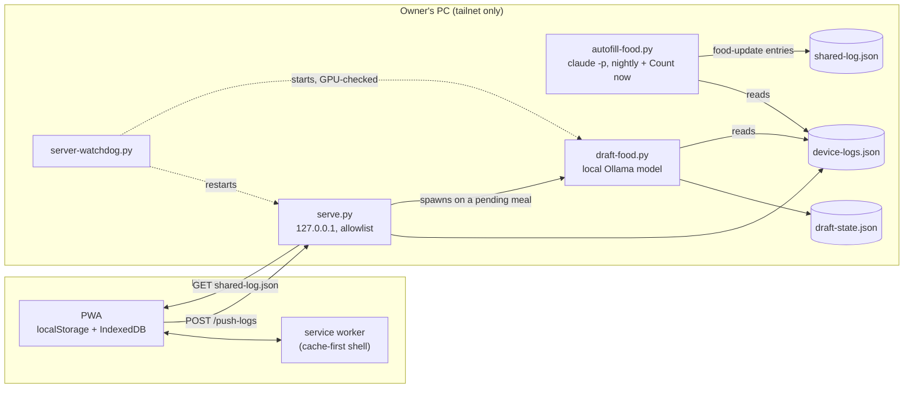

# Architecture

The app has two halves that share no code and talk only through files and three HTTP endpoints:

- **The PWA** (`index.html`, `styles.css`, `app/*.js`, `data/*.js`, `sw.js`, `manifest.json`): plain
  HTML/CSS/JS, no framework, no bundler, no dependencies. All state lives in the phone's `localStorage`
  (plus IndexedDB for meal photos waiting to upload). It works with no network.
- **The companion server and agents** (`serve.py`, `server-watchdog.py`, `autofill-food.py`,
  `draft-food.py`, `food_common.py`): Python standard library only. They run on the owner's PC, reachable
  from the phone over a private Tailscale network. They are optional: the public demo runs without them.

## The client

### Load order

`index.html` loads classic scripts in a fixed order. Top-level `const`/`let` are shared across them, but a
top-level statement can only use what the same or an earlier script declared, so the order is part of the
design (the harness runs the files the same way and turns a violation into a failure):

| File | Role |
|---|---|
| `app/config.js` | engine constants shared by every profile: load types, sections, nutrients, sync and draft timings, the inbox contract, `cfgFail`, `appBanner`, `lsSet`, the log-parse memo |
| `data/profile.js` | the person: goal, daily targets, food list, supplement stack, branding, `SERVER` |
| `data/program.js` | the program: block dates, phases, targets, base weeks (`BASE_EPOCHS`), gym sessions, Why tab |
| `data/overrides.js` | dated one-off schedule changes (`WEEK_OVERRIDES`) |
| `data/seed.js` | first-open localStorage seed (the demo's history; `null` for a real install) |
| `app/diagrams.js` | the stick-figure diagram library, the tween engine, the muscle map |
| `app/schedule.js` | data-contract guard, epoch/override/session resolution (`dayObj`), config sanity check, app state, week and phase |
| `app/plan.js` | Plan tab: targets, exercise cards, set logging with a plate picker, notes, workout CSV, Sheet sync, End Workout |
| `app/food.js` | bodyweight, cardio, food picker, meal capture (pending meals, queued photos), drafts, the status strip, Meal History |
| `app/sync.js` | the shared-log inbox merge and the device push |
| `app/main.js` | startup renders, timeline, rest timer, foreground re-sync, service-worker registration and update flow |

`docs/data-contract.md` documents every global the `data/` files must declare. The engine checks them all
at startup (`DATA_CONTRACT`) and stops with a banner naming any that are missing.

### What a day shows: read-time resolution

Nothing about the schedule is stored per day. `dayObj(weekday, date)` computes it every time it is asked:

1. **Base epoch.** `BASE_EPOCHS` is an ascending list of `{from, days, why}`. The epoch whose `from` is the
   latest one on or before the date supplies the base week. A program change adds an epoch instead of
   editing the old week, so every past date still resolves against the week that was live then.
2. **Monday rotation.** In the first epoch, Monday's main block rotates weekly through `MON_VARIANTS`,
   picked by the date's program week (`progWeekOf`).
3. **Dated override.** If a `WEEK_OVERRIDES` block covers the date and names that weekday, its fields merge
   over the base (`{...base, ...override, secs: {...base.secs, ...override.secs}}`). Blocks expire on their
   own and are never deleted.
4. **Picked session.** In an epoch with a session picker, a gym session picked for that date
   (`dj-session-<date>`) wins over both, because it records what was actually trained.

Logged sets and notes are keyed by `day + section + index` (`dj-exlog-wedmain0`) plus a date, so
`exNameFromExlogKey(slot, date)` resolves any historical note back to an exercise name through the same
function. That is why old overrides and epochs stay in the data forever: deleting one would re-label history.

### Storage

All keys start with `dj-` (a contract with the PC side, see `docs/data-contract.md`):

| Key | Holds |
|---|---|
| `dj-workout-log` | every logged set `{id, date, day, exercise, weight, sets, reps, unit?, ld?, plates?, note?}` |
| `dj-foodlog-YYYY-MM-DD` | that food day's entries; a meal is `pending` until it is counted |
| `dj-bw-log`, `dj-cardio-log` | weigh-ins, cardio minutes |
| `dj-exlog-<slot>`, `dj-exlog-archive` | free-text notes per exercise slot; the archive End Workout moves them into |
| `dj-done-<date>`, `dj-plates-<date>`, `dj-session-<date>` | today's checkmarks and plate picks; the gym session picked for a date |
| `dj-shared-imported-ids`, `dj-workout-log-synced`, `dj-food-synced-ids` | dedup sets for the inbox and the Sheet sync |
| `dj-push-seq`, `dj-push-last` | the device push's counter and last success time |

Every write goes through `lsSet()`, which turns a full store into a visible banner instead of a lost save.
`loadWorkoutLog()` and `foodLogFor()` parse through a per-render memo (`lsJSON`) that is checked against
the stored string and dropped on every write.

The **food day** rolls at `FOOD_DAY_ROLL_HOUR` (4 AM), so a meal eaten after midnight counts toward the
previous day (`todayKey()`); the workout side uses the calendar day (`localDayKey()`).

### Service worker

`sw.js` precaches the shell (`SHELL`: every file `index.html` and the manifest load) under a versioned
cache name and serves it cache-first, refreshing in the background. Files the PC writes (`shared-log.json`,
`server-synced.json`, `autofill-state.json`, `draft-state.json`) and media (`food-photos/`, `videos/`) are
network-only. An offline navigation falls back to the cached `index.html`; any other miss is an explicit
503. A new version reloads by itself right after launch, or shows a "New version ready" toast when the
user is mid-edit. `tests/test_shell_consistency.py` keeps `SHELL`, the `index.html` tags and the server
allowlist identical.

## The PC side

| Process | What it does |
|---|---|
| `serve.py` | static server on `127.0.0.1` with an allowlist (everything else is a 404, nothing is listed); `POST /push-logs`, `/request-fill`, `/upload-food`, `/upload-video`; serves the private data overlay |
| `autofill-food.py` | the only thing that **counts** a meal: one headless `claude -p` call for all pending meals, nightly at 04:30 and on "Count now"; answers through `shared-log.json` |
| `draft-food.py` | a quick **draft** estimate per pending meal from a local model (Ollama), spawned by `serve.py` after a push; never counted |
| `server-watchdog.py` | restarts `serve.py` and the GPU-pinned Ollama instance if they are down, and checks the GPU placement after each start |
| `food_common.py` | the helpers all three share: atomic writes, run locks, the pending-meal scan, the "needs a draft" rule, nutrient keys from `app/config.js` |

The data paths, end to end:

- **Phone → PC (device push).** After any change (4 s debounce), on load and on foreground, the app POSTs a
  snapshot of every `dj-` key to `/push-logs`. `serve.py` writes it atomically to `device-logs.json`
  (keeping the previous one) and refuses a snapshot whose `seq` is older than the stored one. Agents read
  this file; it is never served.
- **PC → phone (inbox).** Agents append entries to `shared-log.json`. The app fetches it on load and on
  foreground and merges new entries by id: new meals, sets, weigh-ins, cardio, and patches to existing
  meals or sets (`food-update`, `workout-update`, `food-move`). Unknown types are skipped, not imported.
- **Meal counting.** A logged meal is saved instantly as `pending` (not in any total). The nightly run (or
  "Count now") sends every pending meal to Claude with the owner's food defaults and writes one
  `food-update` per meal. Errors and skips stay pending with a reason the app shows.
- **Drafts.** Within about a minute, `draft-food.py` writes an approximate estimate to `draft-state.json`;
  the app shows it as `≈N kcal, draft` in a separate, not-counted line.

`docs/agent-contracts.md` has the exact shapes and rules; `docs/operations.md` covers running it.

## Testing

- `harness/harness.js` runs the real app files in order inside one Node `vm` context with DOM,
  `localStorage` and `Date` stubs, at pinned dates. Public sections assert behaviour derived from the
  loaded data, so they pass on the demo and on a private overlay. The owner's private sections add dated
  checks and a byte-diff of rendered output against the last single-file version, which is how the
  module split was proven to change nothing.
- `tests/` (pytest) covers the server allowlist, POST hardening, the seq rule, `food_common`, the draft
  requests to Ollama, and shell consistency.
- CI runs both (the harness under UTC and under a time zone with daylight saving, since day keys are local time).
